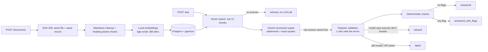

# Docs Q&A Assistant

[](https://github.com/viditrailko-del/docs-qa-assistant/actions/workflows/tests.yml)

A backend service that answers questions from company documents with an LLM (Gemini). It is
built to be **safe when the LLM is wrong**: every answer cites exact quotes, the citations
are checked in code, and the assistant refuses when the documents don't say.

The chatbot is the easy part. This project is about the reliability layer around it, and
about measuring it: an eval harness counts how often a wrong answer would reach a user
looking verified (**confident-wrong answers**), on 61 hand-labeled questions.

**Live demo: https://docs-qa-assistant-demo.onrender.com** (free server: the first visit can take about a
minute to wake it). Replay 14 recorded questions (everyday questions, ones the documents can't answer, prompt
injections, mistakes the checks caught, and what they can't catch) through the real search and checks, or ask
your own on real Gemini (capped per day). How it's built: [demo/DEPLOY.md](demo/DEPLOY.md).

Documents: 60 pages of the public [GitLab Handbook](https://handbook.gitlab.com) (benefits,
leave, expenses, travel, referrals...), as an "employee helpdesk" corpus. Built on the public
GitLab Handbook; not affiliated with or endorsed by GitLab (see [corpus/SOURCE.md](corpus/SOURCE.md)).

I architected the retrieval and verification pipeline, designed the deterministic quote/number/scope checks, built the 61-question eval harness, and verified every label and verdict by hand using Claude Code as a pair-programming tool during implementation.

## How it works



- **Statement-level citations.** The model returns the answer as statements, each with
  `[S1]`-style source labels and an exact quote. Labels map back to retrieved chunk ids.
- **Checks are pure functions** ([app/checks/](app/checks/)), run on every answer:

  | check | severity | catches |
  |---|---|---|
  | `unknown_source` | error | cites a source the model wasn't shown |
  | `quote_not_in_source` | error | the quote isn't in the cited chunk (only quotes, dashes, case, spacing, `**` are forgiven) |
  | `number_unsupported` | error | a number in a statement appears in none of the sources *that statement* cites ($1,500 = 1500) |
  | `scope_mismatch` | warning | a general question answered only from country/entity-specific pages (per statement, and for the whole answer) |
  | `weak_retrieval` | warning | opt-in similarity floor (off: no threshold separated the data) |

- **Refusing is a correct answer.** No retrieved sources → refused without an LLM call; the
  prompt makes the model refuse when the sources don't answer, and say what's missing.
- **Nothing crashes.** Overloads and timeouts are retried with backoff, then a fallback model;
  a daily quota goes straight to the fallback; invalid output is retried once with the
  errors. Anything still failing is status `failed` (HTTP 200), never a 500.
- **Nothing is overwritten.** Every LLM call (raw text, model, prompt version, tokens, cost,
  latency) is stored in `llm_calls` before parsing. Prompts are versioned files.

## Eval results

61 questions written from the documents and verified by hand: 37 simple, 8 multi-passage,
6 tricky (decoy passages), 3 where the documents contradict themselves, 7 unanswerable.
Each has key facts and the exact source quotes.

**Retrieval** (no LLM, free; relevant = chunk containing a label quote):

| method | hit@1 | hit@5 | hit@10 | MRR |
|---|---|---|---|---|
| **vector (default)** | 0.62 | **0.92** | 0.96 | **0.75** |
| keyword (Postgres full-text) | 0.40 | 0.68 | 0.77 | 0.52 |
| hybrid RRF, keyword weight 0.3 | 0.64 | 0.89 | 0.91 | 0.74 |

**Answers**, all 61 questions on `gemini-3.5-flash-lite`, each change measured on its own.
Verdicts by key-fact match, every doubtful one reviewed by hand; all rows scored against the
same (final) labels:

| | confident-wrong | answerable correct | over-refusals | unanswerable refused | cost / question |
|---|---|---|---|---|---|
| start: prompt v1, top 8 chunks | 6 (10%) | 87% | 2 | 6 / 7 | $0.0016 |
| + stricter scope check (re-score, no new calls) | 5 (8%) | 87% | 2 | 6 / 7 | $0.0016 |
| + top 12 chunks | 4 (7%) | 93% | 1 | 6 / 7 | $0.0019 |
| **+ prompt v2 (current default)** | **2 (3%)** | **93%** | 2 | **7 / 7** | $0.0022 |

*Confident-wrong* = a wrong or incomplete answer shown with no warning: the failure that
matters most. In the final run, 98% of 108 quotes are found word-for-word in the cited
source, every answer cites the labeled evidence, and median latency is 5 s.

What the numbers taught:

- **No answer invented a quote or a number.** The wrong answers were omissions, wrong-scope
  answers, and above all **missing evidence**: 4 of the first 6 failures happened because the
  passage that answers the question was ranked 9th-11th and the model only saw the top 8. The
  fix was retrieval, not a smarter check.
- **The checks catch fabrication, not omission.** Quote and number checks flagged 0 of the
  original wrong answers, because every quote was real. They stay (they're what makes a fake
  citation impossible to pass off as checked), and the eval is what measures the rest.
- **A safer prompt has a price.** v2 refuses general questions that only country-specific
  pages answer. That fixed a confident-wrong answer (u07) and turned q30 into a refusal: its
  company-wide passage is never retrieved, so the model now says it only sees country pages
  instead of generalizing from them. A refusal is the safe way to be wrong.

Still wrong: **q24** omits that the referral bonus is paid after 3 months; **q27** reports
one of two conflicting referral rules because the other passage ranks 23rd.

## Findings → fixes

| finding (how it was found) | fix | result |
|---|---|---|
| Hybrid search never beat plain vector search; Postgres `ts_rank` has no IDF (retrieval eval) | vector is the default | done |
| No similarity threshold separates answerable from unanswerable questions without overfitting (retrieval eval) | refusing is the model's job, measured by the eval; threshold is opt-in | done |
| Gemini's response schema rejects `pattern` / `minItems` (Phase 3) | rules in Pydantic validators; a test keeps unsupported keywords out of the schema | done |
| "16 weeks of parental leave" generalized from Canada/UK pages (smoke test) | `scope_mismatch` check | flags it; with prompt v2 the model refuses instead |
| u07: "how do I record my hours?" answered with France-only rules, every sentence naming France, so no check fired (answer eval) | `scope_mismatch` also checks the whole answer; prompt v2 refuses such questions | caught, then refused |
| 4 of 6 wrong answers lacked their evidence: ranked 9th-11th, the model saw 8 (answer eval) | `retrieval_k` 8 → 12 (k=20 adds nothing) | evidence shown 87% → 93%; q23, q42, q47 fixed |
| "Rival value" check idea for conflicts: a different number of the same kind in an uncited source (answer eval) | measured on the frozen answers: fired mostly on correct answers, missed its target | **rejected** |
| Answers left out conditions or pointers ("see the slide deck") | prompt v2 rule: include conditions, say where details live | q54 fixed, q24 not |
| u01 "unanswerable" was answered from a real passage the label missed (answer eval) | relabeled as tricky q54 (labels follow the documents) | label fixed |
| Key-fact scoring missed "complying" vs "comply", "five" vs "5" (answer eval review) | matcher handles inflections and number words | done |
| A DNS outage during an eval crashed 13 questions: connection errors weren't caught, and in the API they'd have been an HTTP 500 | network errors are retryable `LLMError`s, ending `failed` | tested |
| q27: the "first to submit" rule ranks 23rd | (BM25 / query rewriting) | open |

## Run it

Everything runs in Docker (Postgres 16 + pgvector, the API, the tests).

```bash
cp .env.example .env            # add GEMINI_API_KEY (free tier is enough)
docker compose up -d --wait     # Postgres on :5433, API on http://localhost:8001/docs
docker compose run --rm -T api uv run --frozen alembic upgrade head
docker compose run --rm -T api uv run --frozen python -m scripts.ingest_corpus    # ~3.5 min, idempotent
docker compose run --rm -T api uv run --frozen pytest -q                          # never calls Gemini
```

Ask a question:

```bash
curl -s localhost:8001/ask -H 'content-type: application/json' \
  -d '{"question": "What is the nightly hotel limit?"}'
```

Evals:

```bash
docker compose run --rm -T api uv run --frozen python -m eval.retrieval                    # free, ~1 min
docker compose run --rm -T api uv run --frozen python -m eval.run answer --model gemini-3.5-flash-lite
docker compose run --rm -T api uv run --frozen python -m eval.run score                    # offline, free
```

`answer` freezes every result (sources with their text, raw LLM output, cost) and can be
resumed across days (`--resume latest --limit 15`) to fit the free-tier quota. `score`
re-runs the checks on frozen answers, so a check change is measured without new LLM calls.

Production image: `docker build -t docs-qa-api .` (runtime deps only, embedding model baked
in and used offline, non-root, JSON logs, healthcheck). Run migrations as a separate deploy
step. Every question logs one `ask_finished` event (status, model, calls, tokens, cost,
latency, flags); the question text itself is not logged.

## License

Code: MIT ([LICENSE](LICENSE)). The handbook snapshot in `corpus/` keeps its own license and
attribution ([corpus/LICENSE](corpus/LICENSE), [corpus/SOURCE.md](corpus/SOURCE.md)).

## Stack

Python 3.12, FastAPI, Pydantic v2, SQLAlchemy 2.0 + Alembic, Postgres 16 + pgvector,
fastembed (`BAAI/bge-small-en-v1.5`, ONNX on CPU), `google-genai`, pytest, uv, Docker.
