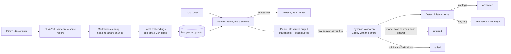

# Docs Q&A Assistant

A backend service that answers questions from company documents with an LLM (Gemini). It is
built to be **safe when the LLM is wrong**: every answer cites exact quotes, the citations
are checked in code, and the assistant refuses when the documents don't say.

The chatbot is the easy part. This project is about the reliability layer around it, and
about measuring it: an eval harness counts how often a wrong answer would reach a user
looking verified (**confident-wrong answers**), on 61 hand-labeled questions.

Documents: 60 pages of the public [GitLab Handbook](https://handbook.gitlab.com) (benefits,
leave, expenses, travel, referrals...), as an "employee helpdesk" corpus. Built on the public
GitLab Handbook; not affiliated with or endorsed by GitLab (see [corpus/SOURCE.md](corpus/SOURCE.md)).

Built with [Claude Code](https://claude.com/claude-code) as a pair programmer. I made the
design and scope decisions, verified every question label and eval verdict by hand, and
reviewed the changes.

## How it works



- **Statement-level citations.** The model returns the answer as statements, each with
  `[S1]`-style source labels and an exact quote. Labels map back to retrieved chunk ids.
- **Checks are pure functions** ([app/checks/](app/checks/)), run on every answer:

  | check | severity | catches |
  |---|---|---|
  | `unknown_source` | error | cites a source the model wasn't shown |
  | `quote_not_in_source` | error | the quote isn't in the cited chunk (only quotes, dashes, case, spacing, `**` are forgiven) |
  | `number_unsupported` | error | a number in a statement appears in none of the sources *that statement* cites ($1,500 = 1500) |
  | `scope_mismatch` | warning | a general question answered only from country/entity-specific pages |
  | `weak_retrieval` | warning | opt-in similarity floor (off: no threshold separated the data) |

- **Refusing is a correct answer.** No retrieved sources → refused without an LLM call; the
  prompt makes the model refuse when the sources don't answer, and say what's missing.
- **Nothing crashes.** Overloads and timeouts are retried with backoff, then a fallback model;
  a daily quota goes straight to the fallback; invalid output is retried once with the
  errors. Anything still failing is status `failed` (HTTP 200), never a 500.
- **Nothing is overwritten.** Every LLM call (raw text, model, prompt version, tokens, cost,
  latency) is stored in `llm_calls` before parsing. Prompts are versioned files.

## Eval results

61 questions written from the documents and verified by hand: 37 simple, 8 multi-passage,
5 tricky (decoy passages), 3 where the documents contradict themselves, 8 unanswerable.
Each has key facts and the exact source quotes.

**Retrieval** (no LLM, free; relevant = chunk containing a label quote, 53 answerable questions):

| method | hit@1 | hit@5 | hit@10 | MRR |
|---|---|---|---|---|
| **vector (default)** | 0.62 | **0.92** | 0.96 | **0.75** |
| keyword (Postgres full-text) | 0.40 | 0.68 | 0.77 | 0.52 |
| hybrid RRF, keyword weight 0.3 | 0.64 | 0.89 | 0.91 | 0.74 |

**Answers** (all 61 questions, `gemini-3.5-flash-lite`, prompt v1, k=8, run 2026-11-16;
verdicts by key-fact match, then reviewed by hand):

| metric | value |
|---|---|
| **confident-wrong answers** (wrong or incomplete, no flag) | **6 / 61 (10%)** |
| answerable questions answered correctly | 89% (47 / 53) |
| unanswerable questions correctly refused | 7 / 8 |
| over-refusals (answerable but refused) | 1 / 53 |
| quotes found in the cited source | 99% of 106 |
| answers citing the labeled evidence | 96% |
| wrong answers caught by a check | **0 / 6** |
| cost / median latency per question | $0.0016 / 2.3 s (0 failures) |

The honest headline: **the checks caught none of the wrong answers.** No answer invented a
quote or a number. Every wrong answer was an *omission* (one side of a contradiction, a
missing condition) or a *scope* error, which quote-level checks can't see. That is the
next thing to fix, and the eval now measures it.

## Findings → fixes

| finding (how it was found) | fix | status |
|---|---|---|
| Hybrid search never beat plain vector search; Postgres `ts_rank` has no IDF, so "team" weighs as much as "USERRA" (retrieval eval) | vector is the default; real BM25 is the open experiment | done / open |
| No similarity threshold separates answerable from unanswerable questions without overfitting (retrieval eval) | refusal is the model's job, checked by the eval; threshold is opt-in only | done |
| Gemini's response schema rejects `pattern` / `minItems` (Phase 3) | rules live in Pydantic validators; a test asserts no unsupported keyword leaks into the schema | done |
| "How many weeks of parental leave?" answered "16" from Canada/UK pages, not the company-wide policy (smoke test) | `scope_mismatch` check; it flags this answer in the full eval | done |
| Key-fact scoring missed "complying" vs "comply", "five" vs "5" (full eval review) | matcher handles inflections and number words; tests added | done |
| Conflicting documents (q23 travel insurance 180 vs 365 days, q27 referral credit): both passages retrieved, only one side answered, `sources_disagree` false | candidate check: two cited/retrieved sources give different values for the asked thing | open |
| Incomplete answers: q24 omits "paid after 3 months"; q47 says the $1,000 amount isn't in the sources although it was | prompt v2 candidate (answer every part of the question; re-read sources before saying something is missing) | open |
| q42 (USERRA military leave, 5 years): the passage was never retrieved, the answer was vague | retrieval: BM25 / keyword boost for rare terms | open |
| u07 (time tracking, should refuse): answered with France-only rules; `scope_mismatch` stays silent because the answer names France | candidate: warn when a general question is answered only from one entity's pages, even if the answer says so | open |

## Run it

Everything runs in Docker (Postgres 16 + pgvector, the API, the tests).

```bash
cp .env.example .env            # add GEMINI_API_KEY (free tier is enough)
docker compose up -d --wait     # Postgres on :5433, API on http://localhost:8001/docs
docker compose run --rm -T api uv run --frozen alembic upgrade head
docker compose run --rm -T api uv run --frozen python -m scripts.ingest_corpus    # ~3.5 min, idempotent
docker compose run --rm -T api uv run --frozen pytest -q                          # never calls Gemini
```

Ask a question:

```bash
curl -s localhost:8001/ask -H 'content-type: application/json' \
  -d '{"question": "What is the nightly hotel limit?"}'
```

Evals:

```bash
docker compose run --rm -T api uv run --frozen python -m eval.retrieval                    # free, ~1 min
docker compose run --rm -T api uv run --frozen python -m eval.run answer --model gemini-3.5-flash-lite
docker compose run --rm -T api uv run --frozen python -m eval.run score                    # offline, free
```

`answer` freezes every result (sources with their text, raw LLM output, cost) and can be
resumed across days (`--resume latest --limit 15`) to fit the free-tier quota. `score`
re-runs the checks on frozen answers, so a check change is measured without new LLM calls.

Production image: `docker build -t docs-qa-api .` (runtime deps only, embedding model baked
in and used offline, non-root, JSON logs, healthcheck). Run migrations as a separate deploy
step. Every question logs one `ask_finished` event (status, model, calls, tokens, cost,
latency, flags); the question text itself is not logged.

## Stack

Python 3.12, FastAPI, Pydantic v2, SQLAlchemy 2.0 + Alembic, Postgres 16 + pgvector,
fastembed (`BAAI/bge-small-en-v1.5`, ONNX on CPU), `google-genai`, pytest, uv, Docker.
